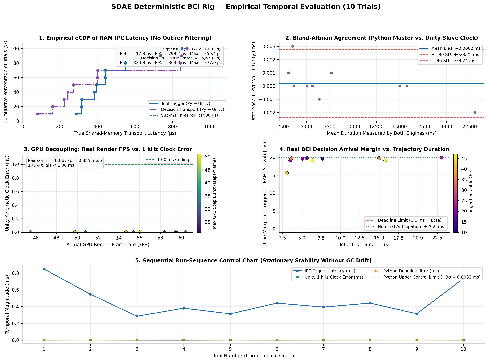

# Deterministic 1 kHz BCI Actuation & Telemetry Rig

**A real-time systems engineering architecture for deterministic software-to-engine transport, clock synchronization, and virtual kinematic actuation.**

This repository is an advanced undergraduate-level middleware and kinematic-actuation project built around the **State-Driven Architecture Engine (SDAE)**. It addresses timing and IPC coupling commonly encountered in Python-to-Unity neurofeedback prototypes by using a shared-memory data path and a Unity-side 1 kHz clock independent of rendered frame cadence.

> **Scope and scientific interpretation.** The benchmarks here validate deterministic **software-to-engine transport and timing synchronization** in a hardware-in-the-loop (HIL) simulation. They do **not** validate a physical EEG/EMG acquisition chain or a live neural decoder. The reported `100.0%` **Rig Sync Accuracy** is 10/10 synthetic benchmark triggers/decisions delivered before the virtual grasp deadline; it is **not biological EEG classification accuracy**. Physical sensors, ADCs, and real-time inference are not coupled in the results shown here.

## At a glance

- **Transport:** 96-byte named shared-memory map, `sdae_bci_memory`, between the Python orchestrator and Unity.
- **Kinematic timebase:** dedicated `SDAE_1kHz_MasterClock` worker thread; 1 ms trajectory steps are not driven by GPU frame rate.
- **Unity integration:** a custom system inserted at the beginning of `EarlyUpdate` dispatches state edges and applies the latest trajectory point.
- **Clock source:** Windows QPC integer timestamps aligned with Python `time.perf_counter_ns()`.
- **Evaluation:** two reported 10-trial runs (Unity Editor stress baseline and Standalone Build), randomized fall speeds and durations, with no outlier filtering.
- **Current boundary:** the notebook's `run_bci_inference()` is a replace-me stub, not a neural decoder. In its current form it returns ground truth in both modes. Unity independently defaults an absent/late decision to `0` (`TIMEOUT`) in testing mode.

## Demonstration and runtime

The scene is an Apple Catcher-style 3D environment with bilateral virtual hands. The diagnostic HUD exposes the state mask, clock rate, trigger/decision transport latency, anticipation margin, kinematic clock error, render FPS, and catch-up step burst.

| Diagnostic HUD enabled | Immersive view (HUD disabled) |
|---|---|
|  |  |

| Closer camera perspective | Wider camera perspective |
|---|---|
|  |  |

The uncut live demonstration video showing the Python notebook and Unity running together during a recorded 10-trial session can be viewed [on Google Drive](https://drive.google.com/file/d/1JSohHxiq0vpsC3KJCx_jpOEP8Mx6w8ER/view?usp=sharing).

## Architecture

```text
Python Benchmark Tester.ipynb
  ├─ Windows timer / scheduling setup
  ├─ perf_counter_ns() timestamps, synthetic trial schedule, CSV, plots
  └─ 96-byte named mmap: sdae_bci_memory
              │
              │ timestamp then publication word; no mutex
              ▼
Apple.cs
  ├─ SDAE_1kHz_MasterClock worker: trigger/decision polling and 1 ms timeline
  ├─ QueryPerformanceCounter clock
  ├─ branchless state mask and O(1) De Bruijn edge dispatch
  └─ Unity EarlyUpdate: hand preparation, trajectory rendering, HUD
              │
              ▼
hand1_script.cs / hand2_script.cs ── virtual hand state and grasp actuation

SDAEngineUnified.cs ── optional low-level signal-ingestion / processing path
```

### Connection to SDAE-engine

The Unity scripts build on concepts from the **[SDAE-engine documentation and test repository](https://github.com/mathiascar7/SDAE-engine)**, including branchless algebraic bitmasks, fixed-size state transitions, and O(1) De Bruijn bit-scan edge dispatch. In `Apple.cs`, `DE_BRUIJN_BIT_POS` maps the isolated lowest set bit to an edge handler without scanning each state bit. `Interlocked.CompareExchange` protects the in-process state-mask update loops; it is not used as a lock on the shared-memory bus. Refer to the linked project for the broader engine documentation and tests; this repository's BCI rig should not be read as implementing or embedding the entire SDAE-engine.

`SDAEngineUnified.cs` contains the unsafe processing and WASAPI capture path associated with the SDAE low-level layer. It allocates channel buffers on 64-byte boundaries, applies Boolean derivatives (`XOR`/`NOR`) and DDBP packing, and defines WASAPI COM capture interfaces. The capture path may fall back to simulation when WASAPI initialization fails. Its presence is an integration surface, not evidence that EEG/EMG hardware was acquired for these benchmarks.

### Lock-free 96-byte shared-memory bus

The two processes open the named map `sdae_bci_memory` with a 96-byte payload. The offsets and field types below match the Python notebook schema and the Unity reader/writer code. “Writer” identifies the normal producer; Unity also clears a few Python-owned publication fields during initialization/trial reset.

| Byte offset | Type | Field | Writer | Description |
|---:|---|---|---|---|
| 0 | `int32` | `trialId` | Python (Unity resets) | Trial publication word; Unity detects a new positive ID. |
| 4 | `int32` | `groundTruth` | Python | Synthetic target: `1` = left, `2` = right. |
| 8 | `int32` | `totalSteps` | Unity | Number of kinematic steps in the trajectory. |
| 12 | `int32` | `decisionDeadlineStep` | Unity | Configured deadline step sent to the orchestrator. |
| 16 | `int32` | `unityState` | Unity | State handshake: standby/configuration, preparing, falling, and done. |
| 20 | `int32` | `decision` | Python (Unity clears) | Prediction publication word: `0` = none, `1` = left, `2` = right. |
| 24 | `int64` | `pythonTriggerTimestampNs` | Python | QPC-aligned trial-trigger timestamp in nanoseconds. |
| 32 | `int32` | `subjectNumber` | Unity | Session subject identifier. |
| 36 | `int32` | `trainingMode` | Unity | `1` = training; `0` = testing. |
| 40 | `float32` | `speedPercentage` | Unity | Fall-speed parameter. |
| 44 | `float32` | `decisionPercentile` | Unity | Kinematic trigger percentile. |
| 48 | `int32` | `unityConfigReady` | Unity | Session configuration publication flag. |
| 52 | `int32` | `benchmarkActive` | Unity | Randomized Benchmark R request/status flag. |
| 56 | `float32` | `unityIpcTriggerLatencyMs` | Unity | Measured trigger publication-to-detection latency. |
| 60 | `float32` | `unityDecisionTransportLatencyMs` | Unity | Measured decision publication-to-detection latency. |
| 64 | `float32` | `unityActualKinematicMs` | Unity | Measured trajectory duration. |
| 68 | `float32` | `unityClockJitterMs` | Unity | Absolute deviation from the requested trajectory duration. |
| 72 | `int32` | `unityMaxFrameStepBurst` | Unity | Largest number of trajectory steps applied in one rendered frame. |
| 76 | `float32` | `unityMeanTrialFps` | Unity | Mean rendered FPS recorded for the trial. |
| 80 | `int64` | `pythonDecisionTimestampNs` | Python | Timestamp written immediately before publishing a decision. |
| 88 | `float32` | `unityAnticipationMarginMs` | Unity | Decision arrival margin relative to the grasp deadline. |
| 92–95 | 4 bytes | Reserved | — | Unused tail of the 96-byte mapping. |

There are no mutexes or locks around this cross-process payload. The producer writes its data and timestamp before the publication word: Python writes the trigger timestamp at offset 24 before publishing `trialId` at offset 0, and writes the decision timestamp at offset 80 before publishing `decision` at offset 20. Unity reads the publication word, applies `Thread.MemoryBarrier()`, and then reads the associated timestamp/payload. Unity likewise writes telemetry before publishing `unityState = 3`. The barrier and ordered publication are the intended producer-consumer protocol; `Interlocked.CompareExchange` is used separately for atomic state-mask transitions inside Unity.

### Native Windows clock synchronization

On Windows, `Apple.cs` P/Invokes `QueryPerformanceCounter` and `QueryPerformanceFrequency` from `kernel32.dll`. It converts QPC ticks to integer nanoseconds using quotient/remainder arithmetic, avoiding a floating-point conversion of the large counter value:

$$T_{\text{ns}} = \left\lfloor \frac{T_{\text{ticks}}}{f_{\text{QPC}}} \right\rfloor \cdot 10^9 + \left\lfloor \frac{(T_{\text{ticks}} \bmod f_{\text{QPC}})\cdot 10^9}{f_{\text{QPC}}} \right\rfloor$$

In code, this is equivalent to:

```text
seconds   = ticks / qpcFrequency
remainder = ticks % qpcFrequency
timestamp = (seconds * 1_000_000_000L)
          + ((remainder * 1_000_000_000L) / qpcFrequency)
```

Python timestamps the same Windows performance-counter epoch via `time.perf_counter_ns()`. This supports direct timestamp subtraction without conversion through floating-point seconds. A `Stopwatch`-frequency fallback exists in the Unity script when the Windows QPC path is unavailable; the benchmark configuration described here is Windows.

### GPU-decoupled 1 kHz clock and PlayerLoop injection

`Apple.cs` starts a dedicated high-priority thread named `SDAE_1kHz_MasterClock`. Its loop advances the elapsed-time-derived trajectory at 1 ms intervals, using a short yield in the earlier part of the interval and a fine spin near the end. During the final millisecond of a trajectory it uses `Thread.SpinWait(10)` to phase-lock to the target end timestamp.

Unity's `PlayerLoop` is extended with a custom callback at the beginning of `EarlyUpdate`. That callback dispatches newly raised state bits through `DE_BRUIJN_BIT_POS`, coordinates Mecanim hand readiness, and applies the latest pre-baked trajectory position. Rendering can therefore catch up by applying multiple steps in one frame; measured catch-up bursts in the supplied figures are workload-dependent (not a hard-coded 50-step cap). The supplied evaluation figures report `0.000 ms` kinematic clock error at displayed precision despite low and varying FPS, including bursts up to roughly 50 steps/frame in the Editor run.

The branchless trigger test is:

$$b_{\text{trig}} = \text{uint}(S_{\text{trigger}} - S_{\text{current}} - 1) \gg 31$$

The trial state mask is updated through compare/exchange loops. A fixed-size edge-dispatch lookup and pre-baked kinematic samples avoid per-step trajectory construction.

### Zero-GC hot paths and Windows scheduling

- Unity stores the trajectory in a preallocated `Vector3[]` (`prebakedTrajectory`), reusing it for each trial.
- Apple alpha changes use a cached `MaterialPropertyBlock`, avoiding per-frame material instantiation.
- The HUD caches formatted text and refreshes it at a throttled interval (`hudRefreshIntervalSec`) rather than rebuilding it on every GUI pass.
- The notebook disables Python garbage collection during deadline-sensitive trial windows and re-enables/collects outside those windows.
- On Windows, the notebook calls `winmm.timeBeginPeriod(1)`, raises the Python process to `HIGH_PRIORITY_CLASS`, raises the active thread priority, and pins the process affinity mask to the last processor bit reported by `os.cpu_count()` (when at least four processors are present). This implementation selects a logical processor index; it does not discover or verify a physical-core topology. Timer resolution is restored with `timeEndPeriod(1)` when the notebook exits its run loop.

These are timing-oriented scheduling choices, not a hard real-time guarantee: Windows remains a general-purpose OS, and scheduler settings do not make a process safety-certified or deadline-infallible.

## Empirical A/B validation

The reported comparison evaluates **N = 10 randomized trials per environment**, with fall speeds from **13% to 97%**, durations from **3.09 s to 27.0 s**, and **zero outlier filtering**. The Unity Editor run is the worst-case stress baseline recorded under simultaneous screen recording; the Standalone Build is the production-runtime comparison. The following are the reported metrics for those two runs.

| Metric | Unity Editor (stress baseline) | Standalone Build |
|---|---:|---:|
| Trial trigger IPC, Python → Unity | P50 `417.8 µs`; max `850.4 µs` | **P50 `194.9 µs`; max `705.1 µs`** |
| Decision transport, Python → Unity | P50 `334.8 µs`; max `877.0 µs` | P50 `582.4 µs`; max `959.3 µs` |
| Decision transports below 1 ms | `10/10` (`100%`) | `10/10` (`100%`) |
| Inter-process clock bias (Bland–Altman) | Mean `+0.0002 ms`; LoA `+0.0028 / -0.0024 ms` | **Mean `+0.0001 ms` (`100 ns`); LoA `+0.0007 / -0.0005 ms`** |
| Trials with displayed `0.0000 ms` clock difference | — | `9/10` |
| Unity 1 kHz kinematic clock error | `0.000 ms` at displayed precision in `10/10` | `0.000 ms` at displayed precision in `10/10` |
| Kinematic error vs. GPU FPS | Pearson `r = -0.067`, `p = 0.855` | Pearson `r = 0.152`, `p = 0.674` |
| Decision anticipation margin | `+15.58 ms` to `+19.90 ms` | **`+19.1 ms` to `+19.9 ms`** |

The Standalone trigger-latency median is a `53.3%` reduction from the Editor baseline:

$$\frac{417.8 - 194.9}{417.8} \cdot 100\% \approx 53.3\%$$

The observed minimum trigger-latency trial was `50 µs`. Both environments kept all 10 measured decision transports below 1 ms, compared with `16,670 µs` for one nominal 60 Hz frame. Clock errors displayed as `0.000 ms` are rounded to the figure's displayed precision; they do not mean physically exact zero error.

Decision anticipation is computed as:

$$M_{\text{ant}} = T_{\text{trigger}} - T_{\text{RAM\_arrival}} > 0\text{ ms}$$

The Bland–Altman limits of agreement are:

$$\text{LoA} = \bar{d} \pm 1.96s_d$$

The smaller Standalone limits indicate tighter agreement in this 10-trial sample. The reported Pearson tests do not show statistically significant correlation between the measured kinematic error and FPS in either run; with `N = 10`, this is evidence from a small sample, not proof of independence across all loads or machines.

### Unity Editor baseline

The Editor figure shows the 10-trial run under simultaneous screen recording, with a reported trigger-latency P50 of `417.8 µs`, max `850.4 µs`, and `0.000 ms` 1 kHz kinematic error at displayed precision across the trials.



### Standalone Build

The Standalone figure reports a `194.9 µs` trigger-latency P50, `+0.0001 ms` mean Bland–Altman clock bias, and `0.000 ms` displayed 1 kHz kinematic error across the 10 evaluated trials.


### Context and limits

For context, Lab Streaming Layer deployments over network sockets commonly report transport latencies in the approximate `1.5–10.0 ms` range, while clinical real-time frameworks such as BRAND report `< 600 µs` using Redis Streams on PREEMPT_RT Linux. These are not controlled, same-workload comparisons. The Standalone result (`194.9 µs` trigger P50) is comparable to sub-millisecond transport, achieved here on standard Windows without an external Redis server; it does not imply equivalent end-to-end acquisition, clinical performance, or scheduling guarantees.

Next validation steps include measuring the physical ADC/EEG front-end path (anticipated `2–15 ms` contribution depending on hardware/configuration), integrating and profiling live DSP/neural inference under load, and running endurance/stress studies with `N ≥ 500` trials. The 10-trial results are preliminary timing evidence only.

## Decision modes and accuracy semantics

- **Training (`trainingMode = true`):** the Unity actuator can use the trial target as a guided fallback if no classifier decision has arrived at the trigger. This supports calibration-style mechanical testing; it is not a classification result.
- **Testing (`trainingMode = false`):** if a valid `1` or `2` decision is not present by the grasp trigger, Unity uses `0` (`TIMEOUT`). The virtual hand remains open, the catch is treated as a miss, and the target runs the cached-material alpha fade-out path.
- **Notebook caveat:** `run_bci_inference()` currently contains a TODO for live EEG inference and returns `ground_truth` in testing mode too. Replace that stub with a real decoder (and ensure it can report no/late prediction) before interpreting `prediction` or `is_correct` as classifier outcomes. The A/B figures and `100.0%` Rig Sync Accuracy describe the timing/actuation harness, not biological EEG accuracy.

The two accuracy labels are intentionally distinct in the Unity HUD: synthetic/calibration or Benchmark R sessions are labeled **Rig Sync Accuracy**; only non-synthetic online sessions are labeled **BCI Classifier Accuracy**.

## Repository contents

The Unity project assets/scenes themselves are not included in this repository snapshot; the C# scripts are intended to be used in the corresponding Unity 6 project.

```text
.
├── Apple.cs
├── Benchmark Test in Build.png
├── Camera Zoom out.png
├── Camera zoom in.png
├── Menu.cs
├── Python Benchmark Tester.ipynb
├── SDAEngineUnified.cs
├── Scene with UI.png
├── Scene without UI.png
├── Subject_02_BENCHMARK_R_20261113_084254_Academic_Performance.png
├── bci_sessions/
│   ├── Subject_02_BENCHMARK_R_20261113_132049.csv
│   ├── Subject_02_BENCHMARK_R_20261113_132049_Academic_Performance.pdf
│   ├── Subject_02_BENCHMARK_R_20261113_132049_Academic_Performance.png
│   ├── Subject_02_TESTING_20261113_125153.csv
│   ├── Subject_02_TESTING_20261113_125153_Academic_Performance.pdf
│   ├── Subject_02_TESTING_20261113_125153_Academic_Performance.png
│   └── Subject_02_TRAINING_20261113_132041.csv
├── hand1_script.cs
└── hand2_script.cs
```

The `bci_sessions/` directory contains raw, unfiltered session CSV telemetry recorded by the notebook, plus generated per-session PNG/PDF figures. New live runs create `Subject_<NN>_<MODE>_<timestamp>.csv` logs there. The standalone and Editor five-panel figures embedded above are located at the repository root.

### File guide

| File | Role |
|---|---|
| `Apple.cs` | Core Unity 6 actuator and telemetry script: 1 kHz master-clock thread, lock-free 96-byte map, QPC nanosecond clock, `EarlyUpdate` injection, De Bruijn state-edge dispatch, pre-baked trajectory, HUD, and target fade feedback. |
| `Menu.cs` | `TerrainDemoScene1` launcher/UI controller for Apple Speed %, Subject Number, Prediction %, Training Mode, and Test UI. Persists settings as `menu_settings_v2.json` under Unity's `Application.persistentDataPath`. |
| `hand1_script.cs` / `hand2_script.cs` | Mecanim hand controllers tracking `Open`/`Close`, animation transitions, and `isFullyOpen` / `isFullyClosed` flags used by the actuator. |
| `SDAEngineUnified.cs` | Low-level SDAE processing and optional WASAPI capture interfaces, including 64-byte-aligned unsafe buffers, Boolean derivatives, and DDBP packing. |
| `Python Benchmark Tester.ipynb` | Python orchestrator for scheduler setup, shared-memory coordination, trial timing, CSV telemetry, and 300 DPI five-panel plot generation. |
| `bci_sessions/` | Raw session telemetry CSV files and their generated session figures. |

## Run the simulation

### Requirements

- Windows (the Python timer/priority/affinity setup and Unity QPC synchronization use Windows APIs).
- Unity 6 project containing the `TerrainDemoScene1` scene and its environment, hand models/Animator Controllers, UI, and references. Those project assets are not in this repository snapshot.
- VS Code with the **Python** and **Jupyter** extensions, Python 3, and `numpy` and `matplotlib` available in the selected Python environment. The notebook uses the Python standard library for timing, memory mapping, Windows API calls, and CSV.

### Unity setup

1. Add `Apple.cs`, `Menu.cs`, `SDAEngineUnified.cs`, `hand1_script.cs`, and `hand2_script.cs` to the Unity 6 project's scripts/Assets area.
2. In `TerrainDemoScene1`, attach `Apple` to the falling target actuator and assign the target renderer/materials, hand references, and any HUD/UI references exposed in the Inspector.
3. Attach `hand1_script` and `hand2_script` to the corresponding hand objects. Configure their Animator states/parameter to match `Open`, `Close`, and `CloseHand`, or update the serialized names to the project's controller.
4. Configure the `Menu` scene object and connect its UI events to the public setters. Add `TerrainDemoScene1` to Unity's Build Settings/Build Profiles scene list.
5. Select the Windows Standalone target for the production-runtime evaluation. The Editor can be used for development and the separately labeled Editor baseline.

### Python and experiment

1. Open `Python Benchmark Tester.ipynb` in VS Code and select a Python environment with `numpy` and `matplotlib`. Install missing packages into that environment if needed (for example, `python -m pip install numpy matplotlib`).
2. Run the notebook's setup/orchestrator cell and select Option `[1]` to connect to the shared-memory bus. It initializes the shared-memory map and waits for Unity configuration; on Windows, it also applies the notebook's timer and scheduling settings.
3. Start `TerrainDemoScene1` in Unity. Confirm the notebook detects the session configuration and then select/run its live trial or Benchmark R workflow. Press `R` in Unity to request the randomized 10-trial Benchmark R run.
4. Choose **Training** for guided harness trials. For meaningful **Testing** behavior, first replace `run_bci_inference()`'s ground-truth placeholder with the intended online decoder and its late/missing-result behavior.
5. The notebook writes raw session CSVs and generates five-panel PNG/PDF plots in `bci_sessions/`. Plot-only mode can generate figures from an existing CSV without running live trials.

Do not treat scheduler priority, a successful virtual grasp, or a zero-rounded timing display as evidence of clinical readiness or safe control of a physical device.

## References and next steps

- SDAE-engine documentation and tests: [github.com/mathiascar7/SDAE-engine](https://github.com/mathiascar7/SDAE-engine)
- Integrate a physical acquisition front end and document its measured end-to-end latency.
- Replace the notebook inference stub with an explicit decoder interface, including missing/late prediction handling.
- Re-run under real inference load, report platform/build details and raw trial distributions, and expand endurance validation to `N ≥ 500`.
